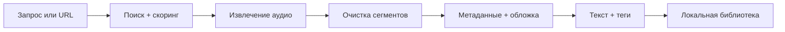

<div align="center">

# 🎵 Melodine

**Studio-first загрузчик музыки с YouTube для аккуратной локальной медиатеки.**

Melodine ищет подходящее аудио, скачивает его, чистит метаданные, добавляет обложку и текст
и сохраняет результат в предсказуемой структуре — через интерактивный TUI или headless CLI.

[](https://github.com/KROFN/melodine/actions/workflows/ci.yml)
[](https://github.com/KROFN/melodine/releases/latest)
[](https://www.python.org/)
[](LICENSE)

**Русский** · [English](README.md)

[Быстрый старт](#быстрый-старт) · [Возможности](#возможности) · [Сценарии](#сценарии) · [Конфигурация](#конфигурация) · [Релизы](https://github.com/KROFN/melodine/releases)

</div>

---

## ✦ Зачем Melodine

Melodine построен поверх [yt-dlp](https://github.com/yt-dlp/yt-dlp), но решает более узкую задачу:
не просто получить аудиофайл с YouTube, а собрать трек, который не стыдно оставить в медиатеке.



Если нужен универсальный загрузчик видео/аудио с максимальным контролем над YouTube — лучше
использовать yt-dlp напрямую. Melodine специально делает больше предположений ради музыкальной медиатеки.

## ⚡ Быстрый старт

Нужны Python **3.10+** и [FFmpeg](https://ffmpeg.org/download.html) в `PATH`.

**Windows:** рекомендуем [Windows Terminal](https://learn.microsoft.com/ru-ru/windows/terminal/install) для полноценной цветовой палитры и современного отображения. В нём можно использовать CMD или PowerShell. Классическая консоль поддерживается в компактном режиме.

**Сеть:** доступность YouTube зависит от региона. При тайм-аутах проверьте подключение на том же устройстве, включая файрвол и настройки уже используемого VPN/прокси. Melodine не управляет сетевыми ограничениями.

```bash
pipx install git+https://github.com/KROFN/melodine.git@v2.0.1
melodine
```

Запуск без аргументов открывает TUI. Короткий алиас `mld` устанавливается вместе с `melodine`.

<details>
<summary><strong>Другие способы установки</strong></summary>

```bash
pip install git+https://github.com/KROFN/melodine.git@v2.0.1

uvx --from git+https://github.com/KROFN/melodine.git@v2.0.1 melodine
```

</details>

> [!IMPORTANT]
> Имя `melodine` на PyPI занято другим проектом. Дистрибутив этого проекта называется
> `krofn-melodine`; пока он не опубликован на PyPI, устанавливайте Melodine с GitHub.

## ✦ Возможности

| | |
|---|---|
| **🎯 Выбор источника**<br>Anti-MV скоринг<br>`Artist - Topic` / `Official Audio`<br>название + длительность<br>`--live`, `--remix`, `--cover`, `--instrumental` | **🧹 Очистка**<br>SponsorBlock<br>очистка YouTube-названий<br>квадратная обработка обложек<br>опциональная EBU R128-нормализация |
| **🎼 Медиатека**<br>LRCLIB и synced `.lrc`<br>iTunes → MusicBrainz<br>variant-aware dedup<br>SQLite, watchlist, M3U8 | **⌨️ Интерфейс**<br>Rich TUI + Typer CLI<br>12 тем, RU / EN<br>graceful Ctrl+C<br>очередь + `--resume` |

> [!NOTE]
> Аудио YouTube уже lossy. FLAC позволяет избежать ещё одного lossy-кодирования после декодирования,
> но не восстанавливает данные, которых не было в источнике.

<!-- Сюда позже можно вставить реальные TUI / CLI скриншоты. -->

## ⌘ Сценарии

### Один трек

```bash
melodine get "Daft Punk - Around the World"
```

<details>
<summary><strong>Версии трека, форматы и прямой URL</strong></summary>

```bash
melodine get "Muse - Hysteria" --live
melodine get "Track" --remix
melodine get "Track" -f opus --normalize
melodine get "https://youtu.be/..." --no-sponsorblock
```

Если нужен конкретный upload без эвристического выбора — передайте прямой URL.

</details>

<details>
<summary><strong>Пакетная загрузка из .txt</strong></summary>

```text
Daft Punk - Around the World
Muse — Hysteria
Massive Attack - Teardrop
```

```bash
melodine get playlist.txt
melodine get playlist.txt -f opus --normalize --no-sponsorblock
```

После прерывания:

```bash
melodine get --resume
```

</details>

<details>
<summary><strong>Watchlist, тексты и экспорт</strong></summary>

```bash
melodine watchlist add "https://www.youtube.com/playlist?list=..." --name "Daily mix"
melodine sync

melodine lyrics ~/Music
melodine doctor

melodine export -f m3u8 --scope library
melodine export -f json
```

</details>

Полный список опций: `melodine <command> --help`.

## TUI ↔ CLI

| TUI | CLI |
|---|---|
| поиск с оценками кандидатов | `melodine get ...` |
| очередь и live-прогресс | batch `.txt` |
| медиатека и история | `export`, `doctor` |
| watchlist manager | `watchlist`, `sync` |
| инструмент текстов | `lyrics <folder>` |
| 12 тем и RU/EN | exit codes для скриптов |

Горячие клавиши: `t` — тема, `g` — RU/EN, `q` — выход, `Ctrl+C` — мягкая остановка
с сохранением незавершённой очереди.

## Как выбирается трек

Для текстового запроса Melodine получает несколько кандидатов через yt-dlp и ранжирует их до скачивания.

**Плюсы к скору:** `Artist - Topic`, `Official Audio`, сходство названия и ожидаемая длительность.

**Штрафы:** music video, reaction, Shorts, live, cover, remix, slowed/sped и другие альтернативные версии.
Intent-флаг снимает только соответствующий штраф: например, `--live` не отключает штраф за `reaction`.

Скоринг намеренно эвристический. Для абсолютного контроля используйте прямой URL.

## Аудио, теги и тексты

| Область | Поведение |
|---|---|
| Аудио | Opus, MP3, M4A/AAC и FLAC |
| Громкость | опциональный двухпроходный FFmpeg `loudnorm` |
| Тексты | LRCLIB exact + fuzzy fallback, synced preferred |
| Обложки | provider artwork; YouTube thumbnails можно привести к квадрату |
| Метаданные | очищенный source metadata + iTunes → MusicBrainz |
| Дедуп | source ID + artist/title/duration + различение вариантов трека |

## Конфигурация

При первом запуске создаётся `config.yaml`. Defaults достаточно для старта; основные параметры
можно менять и из TUI.

<details>
<summary><strong>Минимальный пример</strong></summary>

```yaml
language: ru
theme: dracula

audio:
  codec: mp3
  bitrate: 320
  normalize: false

sponsorblock:
  enabled: true
  categories: [music_offtopic, sponsor, intro, outro, selfpromo]

lyrics:
  enabled: true
  synced: true
  save_lrc: true

metadata:
  enrich: true

output:
  folder: ./downloads
  template: "{artist}/{album}/{track_num} - {title}.{ext}"
```

</details>

## Переход с v1

- v1 `config.yaml` мигрирует в новую модель;
- существующая SQLite-база мигрирует на месте и сохраняет историю;
- все семь исходных тем остаются;
- `python main.py` остаётся compatibility launcher.

Внутренний Python API в v2 сильно изменился. Поддерживаемые пользовательские интерфейсы —
`melodine` / `mld` CLI и TUI.

Перед первым запуском v2 на важной медиатеке разумно сохранить копии `config.yaml` и `melodine.db`.

## Разработка

```bash
git clone https://github.com/KROFN/melodine.git
cd melodine
pip install -e ".[dev]"
pytest
ruff check .
```

Тесты по умолчанию блокируют случайный реальный сетевой доступ.
Для ручных live-smoke запусков: `MELODINE_TEST_ALLOW_NETWORK=1`.

## Ссылки

- [Последний релиз](https://github.com/KROFN/melodine/releases/latest)
- [Changelog](CHANGELOG.md)
- [Issues](https://github.com/KROFN/melodine/issues)
- [PR #2: v2 overhaul](https://github.com/KROFN/melodine/pull/2)

## Credits

Melodine использует [yt-dlp](https://github.com/yt-dlp/yt-dlp), [Rich](https://github.com/Textualize/rich),
[Typer](https://typer.tiangolo.com/), [Pydantic](https://docs.pydantic.dev/),
[Mutagen](https://github.com/quodlibet/mutagen) и [Pillow](https://python-pillow.org/).

Интеграции: [SponsorBlock](https://sponsor.ajay.app/), [LRCLIB](https://lrclib.net/),
[MusicBrainz](https://musicbrainz.org/) и
[iTunes Search API](https://developer.apple.com/library/archive/documentation/AudioVideo/Conceptual/iTuneSearchAPI/).

## Лицензия

[MIT](LICENSE) © KROFN
